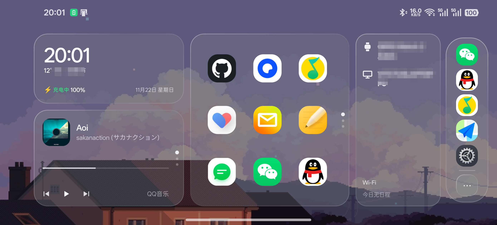
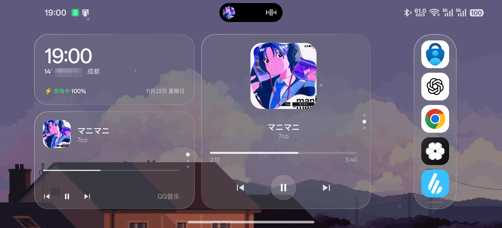
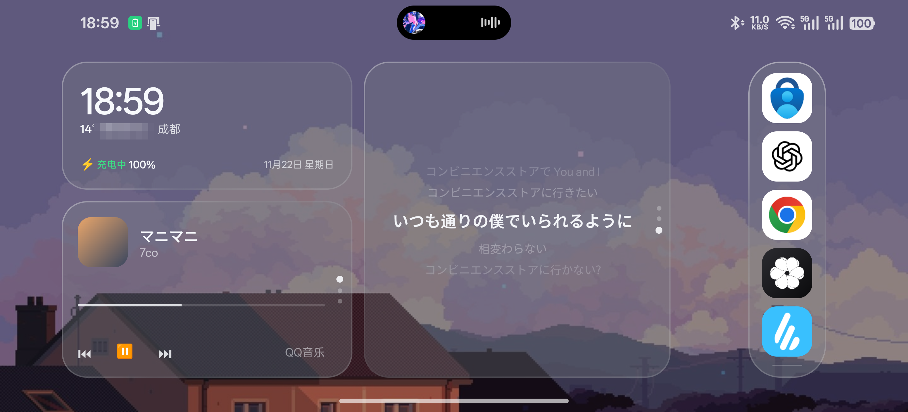

# Luma

一个 Android 横屏信息面板：把时间、天气、音乐、日程、通知、应用入口，收进一块磨砂玻璃里。

不是桌面启动器，不接管 HOME 键，退出后回到系统桌面。

## 下载

安装包在 [Releases](https://github.com/YCLin001/luma/releases/latest) 页面，下载 `Luma-0.1.apk` 直接安装即可，要求 **Android 12（API 31）及以上**。

> 安装包用 debug keystore 签名，适合个人侧装；上架应用商店需要换正式签名。



<table>
<tr>
<td></td>
<td></td>
</tr>
<tr>
<td>播放器大卡（封面 / 进度 / 控制）</td>
<td>实时歌词（按播放位置高亮）</td>
</tr>
</table>

---

## 特性

**布局**
- 锁横屏（含反横屏），手机 20:9、16:9 与平板 4:3 共用一套布局，按容器实际尺寸运行时计算，不靠资源限定符切布局
- 三区结构：左侧信息区 / 中间主展示区 / 右侧 Dock
- 浅色壁纸、深色壁纸都能读：玻璃卡是「黑色薄底压暗 + 白色薄层提亮 + 1px 渐变高光边」

**左侧**
- 大号时钟、日期、天气（Open-Meteo 真实数据，免 key；按定位自动识别城市，定位失败可在菜单里手选）
- 电量：充电中显示绿色闪电 + 百分比，平时显示「电量 xx%」
- 三张卡片上下滑动切换：音乐 / 日历 / 通知

**中间**
- 三页竖向滑动，卡片外框固定不动
  1. 3×3 应用矩阵，点击打开，长按换图标
  2. 播放器大卡：专辑封面、歌名、歌手、进度、上一首/播放暂停/下一首
  3. 实时歌词：Apple Music 式居中排版，当前行加粗放大，相邻行递减透明度

**右侧**
- 满高玻璃竖栏：上半是蓝牙已连接设备（耳机 / 手表 / 电脑 / 通用图标，名称支持两行），下半是同色的网络状态与今日日程摘要
- Dock：5 个固定应用 + `⋯` 设置入口，长按图标可替换

**其他**
- 点 `⋯`：换壁纸（系统相册）/ 用系统壁纸 / 关闭
- 通知卡支持右滑清除单条通知
- 蓝牙设备电量：设备暴露标准 Battery Service 时自动显示，读不到就整段不显示

---

## 环境要求

| 项 | 版本 |
|---|---|
| minSdk | 31（Android 12） |
| targetSdk / compileSdk | 35 |
| Kotlin | 2.0.21 |
| AGP | 8.7.3 |
| Gradle | 8.9 |
| JDK | 17 |
| Compose BOM | 2024.09.00 |

依赖只有 `core-ktx`、`activity-compose`、`lifecycle-runtime-ktx`、`compose ui/foundation/material3`，没有第三方 UI 库。

---

## 构建

项目里带了两个脚本（Windows / MSYS Bash 环境，路径按需改）：

```bash
# debug 包
tools/luma/build.sh

# release 包（R8 + 资源压缩 + debug key 签名）
tools/luma/build-release.sh
```

产物：

```
app/build/outputs/apk/debug/app-debug.apk
app/build/outputs/apk/release/app-release.apk
```

**国内网络注意**：`settings.gradle.kts` 里只保留了阿里云镜像（`maven.aliyun.com` 的 google / public / gradle-plugin），因为 `dl.google.com` 直连会超时。如果镜像缺包，构建会直接报错而不是卡住，方便定位。

`local.properties` 里的 `sdk.dir` 指向本机 SDK 路径，换机器需要改。

---

## 项目结构

```
app/src/main/java/com/luma/lite/
├── MainActivity.kt      入口，锁横屏，调试用 --ei center 1/2 直达指定页
├── Ui.kt                Home 骨架、玻璃 Modifier、时钟卡、Dock、换图标面板、菜单
├── Center.kt            中间三页：应用矩阵 / 播放器 / 歌词
├── Cards.kt             左侧三卡：音乐、日历、通知（含右滑清除）
├── Music.kt             MediaSession 读取与打分选会话、封面回退、媒体键控制
├── Lyrics.kt            LRC 解析、在线匹配、缓存
├── Bluetooth.kt         已连接设备、GATT 电量探测、网络状态、玻璃竖栏
├── Providers.kt         天气、日历、通知监听服务、进程内状态 Hub
├── Prefs.kt             壁纸文件、Dock/矩阵槽位持久化
├── Device.kt            电量与充电状态
└── Apps.kt              应用列表、图标加载、启动
```

---

## 几个实现要点

**自适应不靠断点切布局**
`BoxWithConstraints` 拿到实际宽高，按比例算三列宽度和图标格子边长（`min(w/3, h/3)`），字号跟容器高度走。同一份代码在 20:9 手机和 4:3 平板上都不会溢出。

**磨砂玻璃是分层的，不是真背景模糊**
黑色 20% 打底 + 白色 14% 提亮 + 1px 线性渐变描边。真背景模糊（`RenderEffect` / haze）在 120Hz + 3.5 倍密度下代价很高，这里用分层近似，帧率稳。

**音乐会话打分，不简单取第一个**
QQ音乐、网易云、Spotify、Apple Music 同时挂在后台时，`getActiveSessions` 返回的不止一个。按 `PLAYING > BUFFERING > PAUSED > STOPPED` 打分，同分再按 `lastPositionUpdateTime` 的新鲜度排序。

**封面四级回退**
`ALBUM_ART` → `ART` → `DISPLAY_ICON` → 三者的 `_URI` 走 `ContentResolver` → 最后兜底用媒体通知的大图（QQ 音乐就只给通知）。

**播放控制走系统媒体键**
`AudioManager.dispatchMediaKeyEvent`，不依赖具体 App 的接口，任何注册了 MediaSession 的播放器都可用。

**歌词**
按「歌名 + 歌手」去匹配 LRC，解析后按播放位置高亮。播放位置用「上次读到的 position + 本地流逝时间」估算，避免每帧问系统。

---

## 权限

| 权限 | 用途 | 授予方式 |
|---|---|---|
| `INTERNET` | 天气、歌词 | 安装即授予 |
| `ACCESS_NETWORK_STATE` | 网络类型与运营商 | 安装即授予 |
| `ACCESS_COARSE_LOCATION` | 天气定位（城市级） | 运行时 |
| `QUERY_ALL_PACKAGES` | 列出已安装应用 | 安装即授予 |
| `READ_CALENDAR` | 今日日程 | 运行时 |
| `BLUETOOTH_CONNECT` | 已连接蓝牙设备 | 运行时 |
| `BIND_NOTIFICATION_LISTENER_SERVICE` | 通知摘要、媒体会话 | 系统设置里手动开启 |

通知监听也可以直接授权：

```bash
adb shell cmd notification allow_listener com.luma.lite/com.luma.lite.LumaNotifService
```

---

## 已知限制

- **蓝牙设备电量读不到**（大多数机型）。Android 没有对第三方开放的蓝牙电量 API，`BluetoothDevice.getBatteryLevel()` 是 `@SystemApi`；只能走 GATT 读标准 Battery Service（`0x180F` / `0x2A19`），而手表的私有 BLE 通道和 Windows 笔记本的经典蓝牙都不暴露它。代码仍保留，遇到开放 BAS 的设备会自动出百分比。
- **歌词只有一个源**（网易云公开接口），冷门歌、小语种歌可能匹配不到，匹配不到显示「这首歌没找到歌词」，不会编造。
- **点击图标只能全屏打开**。测试机型为OPPO系手机，系统ColorOS 的「浮窗」是窗口管理器层的虚拟屏 + 缩放（dump 里 `mode` 仍是 `fullscreen`，bounds 越界，带 `mPuttDisplayFlag` 私有字段），没有任何公开接口可以唤起；AOSP 的 freeform 在这台机器上也被 ROM 关闭了。代码里保留了 `tryFreeform()`，在真正支持 `FEATURE_FREEFORM_WINDOW_MANAGEMENT` 的设备上会自动走小窗，失败回落全屏。
- **平板比例未在真实平板上验证**，目前只在手机上用 `wm size` 模拟过，兼容性存疑。

---

## 版本

- `0.1` — 首个可安装版本：三区布局、堆叠卡、中间三页、Dock、蓝牙竖栏、自定义壁纸与图标、通知右滑清除。
