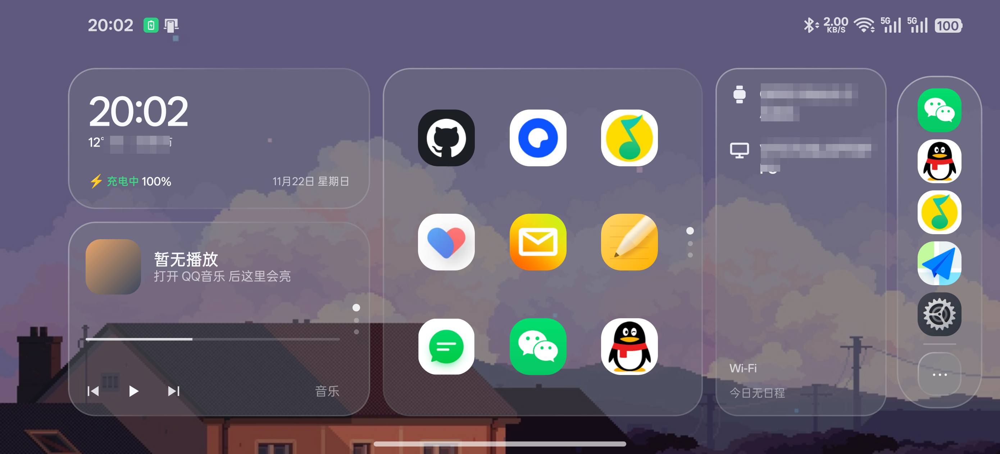
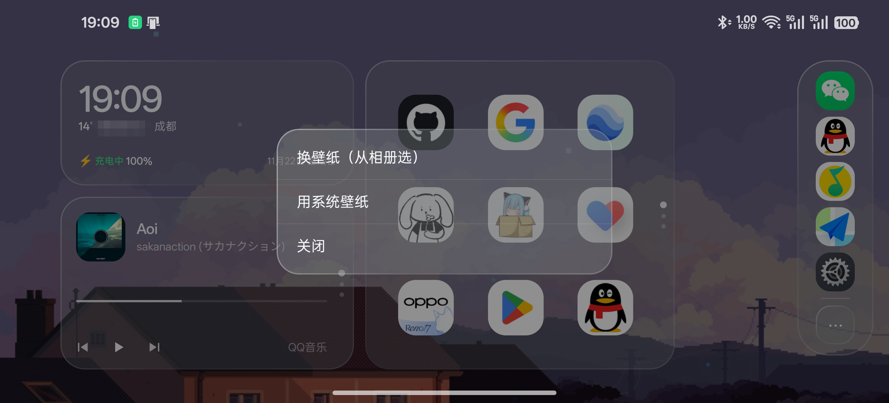
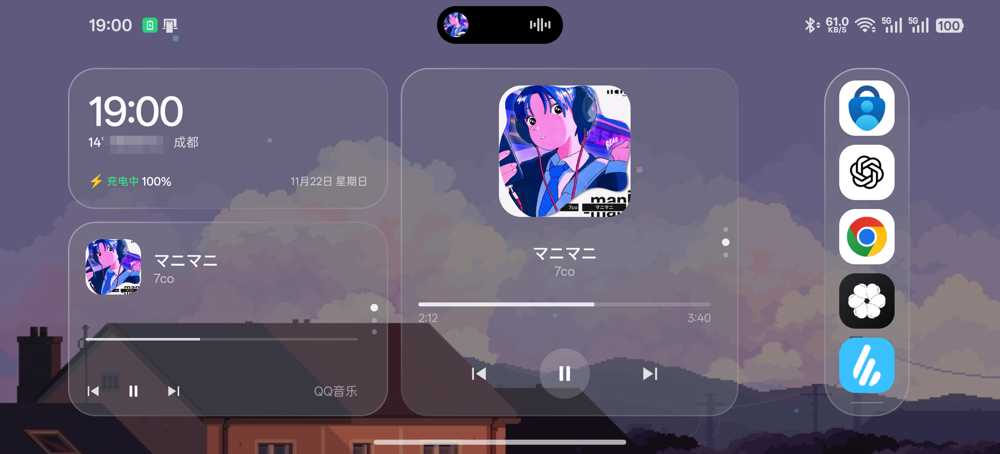
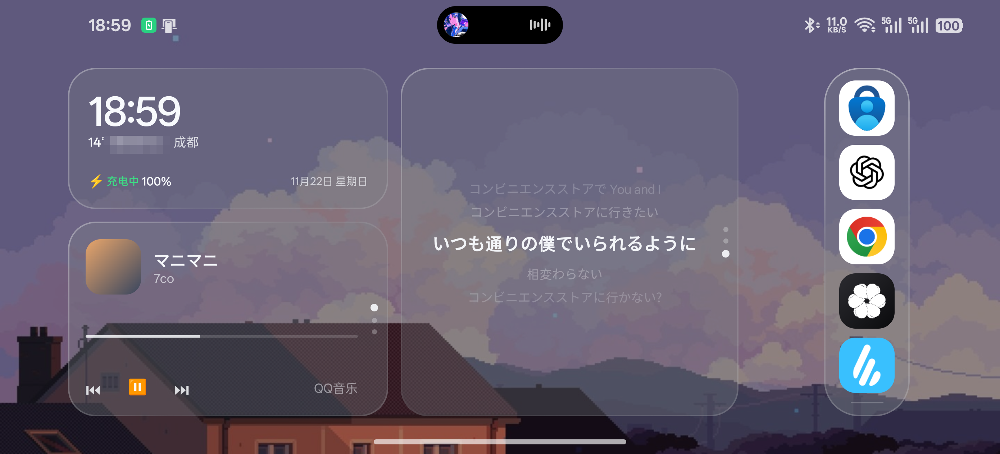

# Luma 使用说明

Luma 是一个横屏的「信息面板」。把手机横过来放，时间、天气、音乐、日程、通知和常用应用都在一屏里，不用来回切 App。

它不是桌面启动器——不会接管你的桌面，也不会替换 Home 键。按返回键或上滑，就正常回到系统桌面。

---

## 第一次打开

会弹两个授权，都建议给：

| 弹窗 | 给了之后能做什么 | 不给会怎样 |
|---|---|---|
| 定位 | 天气自动显示你所在的城市 | 天气显示「未定位」，要手动选城市 |
| 日历 | 中间那张卡显示今天的日程 | 卡片显示「还没给日历权限」 |
| 蓝牙 | 右侧竖栏显示已连接的耳机/手表/电脑 | 竖栏不出现 |

还有一个要手动开：**通知使用权**。在手机设置里搜「通知使用权」，找到 Luma 打开就行（不同品牌路径不一样，搜最快）。

开了之后：左边通知卡才会有内容，音乐卡才能读到正在播放的歌和封面。

> 不给也能用，只是对应那块一直空着，不会报错。

---

## 界面上有哪几块

整屏分三块，从左到右：

### 左边：信息区

上面一张卡是**时钟、日期、天气、电量**。天气会自己更新，显示你所在城市的实时天气。

> 充电时这里会出现一个绿色闪电和「充电中 100%」，拔掉线就变成「电量 78%」。

下面一张卡是**三张卡片叠在一起**，上下滑动切换：

1. **音乐** —— 正在播放的歌、封面、进度
2. **日历** —— 今天有几件事、几点、叫什么
3. **通知** —— 最近收到的通知

右下角那三个小点是页码，告诉你现在在第几张。

### 中间：主展示区

也是**上下滑动切换**，三页内容不会动，卡片外框不动：

1. **应用九宫格** —— 9 个常用应用，点一下就打开
2. **播放器** —— 大封面、歌名、进度条、上一首/暂停/下一首
3. **歌词** —— 跟着音乐走的实时歌词，当前那句会变大加粗

### 右边：竖栏 + 停靠栏

最右边那条玻璃是**蓝牙和设备状态**：上面列着当前连着的耳机、手表、电脑，下面是网络状态和今天的日程摘要。

再右边那一列图标是 **Dock**：5 个固定应用，加最下面一个 `⋯`。

---

## 五个你一定会用到的操作

### 1. 换壁纸

点 Dock 最下面那个 **`⋯`** → 选「换壁纸（从相册选）」→ 挑一张图。

想换回原来系统的壁纸，同一个菜单里选「用系统壁纸」。

### 2. 换图标

**长按任意一个图标**（九宫格里的、Dock 上的都行），会弹出一个应用列表，点谁就换成谁。

选错了点右上角「恢复默认」。

### 3. 换 Dock 上的应用

跟换图标一样，长按 Dock 上的图标就行。

### 4. 清掉一条通知

通知卡上，**从右往左滑**那条通知，就清掉了——系统通知栏里那条也会一起消失。

### 5. 控制音乐

中间滑到播放器那页，或者用左边音乐卡上的按钮。上一首、播放暂停、下一首都能点，QQ音乐、网易云、酷狗、Spotify、Apple Music 都支持——**哪个在放就控制哪个**。

---

## 手势一览

| 想做的事 | 怎么做 |
|---|---|
| 切换左边卡片（音乐/日历/通知） | 在左边卡片上**上下滑** |
| 切换中间内容（应用/播放器/歌词） | 在中间卡片上**上下滑** |
| 打开一个应用 | **点**图标 |
| 换某个位置的图标 | **长按**那个图标 |
| 清掉一条通知 | 在通知上**右滑** |
| 换壁纸 | 点 Dock 的 **`⋯`** |
| 回到系统桌面 | 按**返回**键或**上滑** |

---

## 常见问题

**Q：为什么歌词显示「这首歌没找到歌词」？**

歌词是按歌名去匹配的。中文歌命中率高，冷门歌、纯音乐、英文歌经常匹配不到。匹配不到就如实显示，不会随便塞一段假的。

**Q：为什么蓝牙设备后面没有电量？**

安卓系统本身不向普通应用开放蓝牙设备电量。只有设备主动报告电量时才显示，你现在的耳机和电脑都没报告，所以只显示名字。

**Q：为什么点开应用是全屏，不是小窗？**

系统级的「悬浮小窗」是手机厂商自己做的功能，没有对第三方应用开放，Luma 没法把别的 App 变成小窗。想要小窗，还是从系统的侧边栏或最近任务里开。

**Q：通知卡一直是空的？**

八成是没开通知使用权。在设置里搜「通知使用权」，找到 Luma 打开。

**Q：天气不准 / 显示的城市不对？**

天气默认按定位自动识别城市。如果定位失败（比如刚开机、室内没信号），卡片上会写「未定位 · 菜单里选城市」，这时点 Dock 的 `⋯` →「更换城市」手动挑一个。选了手动城市后就会一直用它，想换回自动就在同一个列表里选「自动定位（当前位置）」。

**Q：切回桌面后 Luma 还在跑吗？**

在。它会在后台待着，切回来立刻是原样。如果你希望它更省电，可以在系统设置里限制它的后台活动，代价是回来时数据要重新刷新一下。

**Q：怎么卸载？**

跟普通应用一样，长按图标卸载，或者 `设置 → 应用管理 → Luma → 卸载`。

---

## 一点小提示

- **横着放更好看**。竖屏也能开，但 Luma 是为横屏设计的。
- 把 Luma 加到桌面快捷方式，横过来点一下就能进。
- 首屏那 9 个格子、Dock 那 5 个位子都可以换成你常用的，换一次会一直记住。
- 升级新版本直接覆盖安装就行，壁纸、图标、Dock 配置都会保留。
